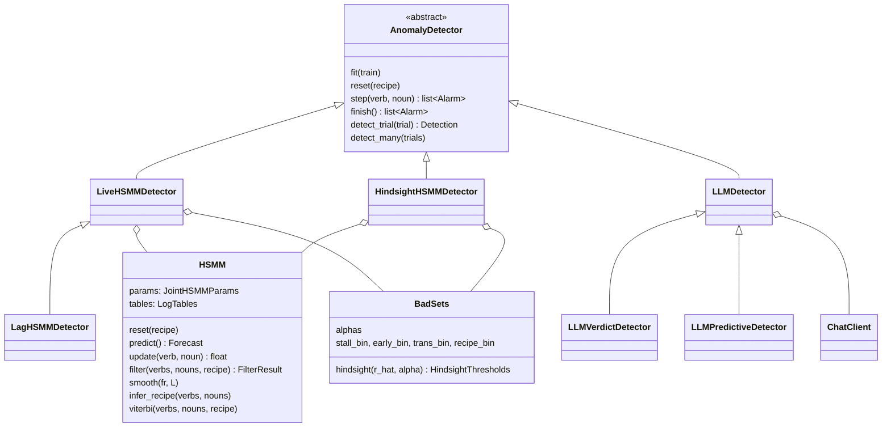

# `cook_ad`: anomaly detection while cooking, for a user with MCI

The system watches a stream of coarse (verb, noun) action labels, one per tick, keeps a belief
about which **subtask** the person is in, how long they have been in it, and which **recipe** they
are making, and raises a few auditable alarms when what it sees departs from what the model
expects. After the session it can turn the alarms into templated questions ("did you skip take
bowl?").

The model is an explicit-duration hidden semi-Markov model with a recipe layer, fitted by EM. It
is deliberately not a neural model: every question traces back to an argmax over a fitted
parameter row. Two LLM detectors are kept as baselines and scored the same way.

| Doc | Covers |
|---|---|
| this file | the system, the classes, the repo map, how to run it, current results, next steps |
| [`model.md`](model.md) | the HSMM: generative story, belief table b_t(r, i, j), filter, smoother, r̂, Viterbi |
| [`detectors.md`](detectors.md) | the detector contract, bad sets, Live / Lag / Hindsight channels, narration |
| [`llm.md`](llm.md) | the two LLM detectors, prompts, the response cache, serving locally |
| [`training.md`](training.md) | the four training stages and their presets |
| [`data.md`](data.md) | corpora, ticks, splits, canonical pools, injected errors |
| [`eval.md`](eval.md) | metric H (headline), metric G, metric E, operating points, the eval scripts |
| [`next_steps.md`](next_steps.md) | planned work: open vocabulary, drift detection |
| [`drift_synth.md`](drift_synth.md) | the synthetic data generator (CaptainCook4D graphs, EPIC vocab, knobs, regimes) and the anomaly detector on it |
| [`logbook.md`](logbook.md) | what was tried, the number, the verdict, newest first |

---

## The classes



A `Trial` goes in, a `Detection(alarms, trace)` comes out; each `Alarm(tick, channel, score,
known_at)` says which tick it is about and when the detector could have raised it. An
`OperatingPoint(alpha, kappa)` sets a detector's sensitivity. `narrate(detection, detector,
vocab)` turns a Hindsight detection into questions. `HSMM` is the only stateful model object; the
detectors hold it, and `BadSets` holds the α-tail sets of one model.

| Detector | Causal | Reads |
|---|---|---|
| `LiveHSMMDetector` | yes | the filter belief b_t; emission p-values and event posteriors at t |
| `LagHSMMDetector(L)` | yes (finite L) | the same, event channels conditioned on L more ticks |
| `HindsightHSMMDetector` | no | r̂ and the Viterbi path of the whole trial |
| `LLMVerdictDetector` | yes (not `batch`) | an LLM's per-run or per-tick verdict |
| `LLMPredictiveDetector` | yes | an LLM's predicted duration and next run, compared by code |

---

## Repository map

```
src/cook_ad/
├── core.py            Trial, Span, Alarm, Detection, OperatingPoint, AnomalyDetector
├── hsmm/
│   ├── params.py      JointHSMMParams, LogTables, load/save, select_recipe
│   ├── durations.py   negative-binomial pmf / survival / cdf tables
│   ├── kernels.py     pure-JAX predict, update, filter, backward, forward pass, Viterbi
│   ├── model.py       class HSMM
│   ├── batch.py       r̂, occupancy and Viterbi over many trials at once
│   ├── visit_counts.py  precedence statistics for the optional s_count channel
│   └── train/         lexical init, joint EM, hard EM, smoothing, duration refit, nonparametric hazard,
│                      global (population) prior, metrics
├── detectors/
│   ├── thresholds.py  class BadSets
│   ├── hsmm_live.py   hsmm_lag.py   hsmm_hindsight.py
│   ├── narrate.py     templated questions from a Hindsight detection
│   └── llm_base.py    llm_verdict.py   llm_predictive.py
├── eval/              metric_g.py, metric_h.py, metric_e.py, pools.py, harness.py, synth_oracle.py
├── llm/               textify, prompts, client (+ cache), detect, predict: LLM plumbing
├── data/              corpus parsers, tick expansion, splits, idle scrubbing
├── synthetic/         healthy sampling, the five injected error types
├── drift_synth/       synthetic longitudinal drift data from CaptainCook4D (no model imports)
└── xla_env.py         process-level XLA flags
scripts/
├── data/              fetch, split, build_pools
├── train/             fit_lexical, fit_hard_em, smooth_params, refit_durations, fit_np_hazard,
│                      fit_visit_counts, train_hsmm.sh
├── eval/              eval_breakfast.py, eval_epic_tent.py, eval_synth_prior.py, llm_*.sh
├── drift_synth/       build_assets, calibrate_cc4d, generate, prior_experiment.sh, rollout_examples,
│                      sanity_plots
├── figures/           trial_figure.py
├── analysis/          participant_variability.py
└── demo_trial.py      one trial through every HSMM detector, tick by tick
configs/               corpus configs; operating_points.yaml (train-picked α, κ); drift_synth/
dataset/processed/     sequences, labels, vocab, splits, pools, fitted .npz, llm_cache/
tests/                 pytest
```

Dependencies point one way: `hsmm` depends on nothing else in `cook_ad`; `detectors` on `hsmm` and
`core`; `eval` on everything; nothing on `eval`.

---

## Running it

Python always goes through `./py` (it pins `PYTHONPATH` to this checkout and stops JAX taking the
whole GPU). Install with the extras, or JAX silently falls back to CPU:

```bash
uv sync --extra dev --extra gpu
```

**The demo.** One test trial through Live and Lag(5) tick by tick, then Hindsight and narration:

```bash
./py scripts/demo_trial.py --trial 3 --inject omission
```

**Train** ([`training.md`](training.md)):

```bash
PRESET=lexhard scripts/train/train_hsmm.sh
```

**Build the pools once, then evaluate** ([`data.md`](data.md) §5, [`eval.md`](eval.md) §5):

```bash
./py scripts/data/build_pools.py
```

```bash
./py scripts/eval/eval_breakfast.py --max-requests 0 --out runs/eval_breakfast.json --operating-points configs/operating_points.yaml
```

LLM arms replay from `dataset/processed/<corpus>/llm_cache/`. A replay needs the original
`--base-url` (Breakfast `http://localhost:11435/v1`, EPIC-Tent `http://localhost:11434/v1`) and
`--max-requests 0`.

**Tests:**

```bash
./py -m pytest -q
```

---

## Results

### Breakfast, injected errors — metric H, delay 2

Test pool: 97 trials per group (healthy + one copy per error type), the same trials for every row.
HSMM operating points picked on the train pool (378 trials per group) by best F1
(`configs/operating_points.yaml`), stage-4b durations. Produced by `scripts/eval/eval_breakfast.py`.

| arm | precision | recall | F1 | alarms / 10 min | run FPR | healthy-trial FPR |
|---|---|---|---|---|---|---|
| null: flag every run | 0.203 | 0.995 | 0.337 | 32.17 | 1.000 | 1.000 |
| null: flag every tick | 0.177 | 1.000 | 0.301 | 32.17 | 1.000 | 1.000 |
| LLM predictive, no recipes | 0.216 | 0.952 | 0.353 | 35.89 | 0.800 | 1.000 |
| LLM predictive, + recipes | 0.254 | 0.918 | 0.398 | 24.88 | 0.639 | 1.000 |
| LLM predictive, no recipes, Auto-CoT | 0.210 | 0.933 | 0.342 | 35.79 | 0.818 | 1.000 |
| LLM predictive, + recipes, Auto-CoT | 0.257 | 0.911 | 0.401 | 24.04 | 0.618 | 1.000 |
| LLM verdict, no recipes (tick) | 0.268 | 0.766 | 0.397 | 28.65 | 0.485 | 0.918 |
| LLM verdict, + recipes (tick) | 0.246 | 0.835 | 0.380 | 32.62 | 0.567 | 0.918 |
| HSMM dish model, dish given: hindsight (α 0.02) | 0.769 | 0.595 | 0.671 | 1.54 | **0.055** | 0.237 |
| HSMM dish model, dish given: live L=0 (α 0.02, κ 0.1) | 0.770 | 0.605 | **0.678** | 1.64 | 0.078 | 0.247 |
| HSMM dish model, dish inferred: hindsight (α 0.02) | 0.767 | 0.584 | 0.663 | **1.39** | **0.055** | **0.227** |
| HSMM dish model, dish inferred: live L=0 (α 0.02, κ 0.3) | 0.702 | 0.627 | 0.662 | 2.28 | 0.098 | 0.330 |
| HSMM 16-cluster model: hindsight (α 0.05) | 0.638 | 0.636 | 0.637 | 2.73 | 0.098 | 0.361 |
| HSMM 16-cluster model: live L=0 (α 0.007, κ 0.02) | 0.727 | 0.589 | 0.651 | 1.98 | 0.090 | 0.289 |
| HSMM `joint_params.npz` at α 0.005 (the older arm) | **0.801** | 0.388 | 0.523 | 0.50 | 0.022 | 0.103 |

Recall per type, metric H, delay 2:

| arm | substitution | abandonment | omission | transposition | repetition |
|---|---|---|---|---|---|
| LLM verdict, + recipes (tick) | 0.99 | 0.80 | 0.68 | 0.88 | 0.77 |
| HSMM dish model, dish given: hindsight | 0.98 | 0.74 | 0.27 | 0.62 | 0.34 |
| HSMM dish model, dish given: live L=0 | 0.98 | 0.74 | 0.31 | 0.63 | 0.34 |
| HSMM 16-cluster model: live L=0 | 0.98 | 0.59 | 0.30 | 0.65 | 0.36 |

### EPIC-Tent, annotated errors — metric H, delay 2

`procedural` group (order, omit, correction, repeat; other types relabelled normal). HSMM fitted on
error-excised train fragments, fixed operating point α 0.005, `s_temporal` 1e-5, κ 0.5 (not picked).
Produced by `scripts/eval/eval_epic_tent.py`.

| arm | split | precision | recall | F1 | alarms / 10 min | run FPR |
|---|---|---|---|---|---|---|
| null: flag every tick | default (9 test sessions) | 0.092 | 1.000 | 0.169 | 45.1 | 1.000 |
| null: flag every run | default | 0.092 | 0.941 | 0.168 | 44.4 | 1.000 |
| LLM predictive, no recipes | default | 0.097 | 0.922 | 0.175 | 55.5 | 0.899 |
| LLM predictive, + instruction order | default | 0.097 | 0.922 | 0.175 | 54.3 | 0.905 |
| HSMM hindsight | default | 0.366 | 0.294 | 0.326 | **2.99** | 0.062 |
| HSMM live L=0 | default | 0.405 | 0.294 | **0.341** | 9.24 | **0.058** |
| null: flag every tick | PREGO (15 test sessions) | 0.104 | 1.000 | 0.188 | 47.7 | 1.000 |
| null: flag every run | PREGO | 0.107 | 0.963 | 0.193 | 46.2 | 1.000 |
| HSMM hindsight | PREGO | 0.400 | 0.318 | 0.354 | **3.32** | 0.065 |
| HSMM live L=0 (= L=5 = L=∞) | PREGO | 0.459 | 0.318 | **0.376** | 8.29 | **0.056** |

Live's alarm rate is three times Hindsight's under H (it was below it under G): H counts every
flagged stretch inside a run, and live channels flicker on and off within a run.
`procedural+temporal` (adds search and slow) tells the same story: on PREGO's split, hindsight F1
0.379, live 0.380, null 0.244.

### EPIC-Tent under PREGO's protocol — metric E

PREGO's split, each session cut at its first procedural mistake, one positive per session (15),
scored step by step as PREGO's code does.

| arm | tp | fp | precision | recall | F1 | correct steps flagged |
|---|---|---|---|---|---|---|
| null: flag every step (on PREGO's own `gt`) | 15 | 153 | 0.089 | 1.000 | 0.164 | 100% |
| null: flag every step (our sequences) | 15 | 124 | 0.108 | 1.000 | 0.195 | 100% |
| PREGO + Llama 2 (published) | | | 0.107 | 0.867 | 0.191 | ~71% |
| LLM predictive, no recipes | 15 | 118 | 0.113 | 1.000 | 0.203 | 95% |
| HSMM hindsight | 3 | 10 | **0.231** | 0.200 | **0.214** | **8%** |
| HSMM live L=0 | 2 | 12 | 0.143 | 0.133 | 0.138 | 10% |

### What the tables say

- **Every HSMM arm beats its null by a wide margin**, at a twentieth (Breakfast) to a fifth
  (EPIC-Tent, Live) of the null's alarm rate. The LLM arms sit 0.005–0.06 F1 above the null and
  flag half to nine tenths of error-free runs.
- **Going live costs nothing in F1.** Live is within −0.001 to +0.022 of Hindsight on every
  Breakfast model and on EPIC-Tent, and lag (L = 5, ∞) buys nothing. Under H its alarm rate on
  EPIC-Tent is three times Hindsight's: its flags flicker within a run.
- **Knowing the dish moves F1 by ≤ 0.01**; the dish model beats 16 latent clusters by 0.01–0.03.
- **The HSMM's weakness is recall** on omission and repetition (Breakfast) and on everything but
  order (EPIC-Tent, where most annotated errors leave the (verb, noun) stream unchanged).
- **Under PREGO's own protocol, flagging every step reproduces PREGO's published result.** The
  HSMM is the only detector not at that null.

---

## Next

- **Open vocabulary** ([`next_steps.md`](next_steps.md) §1): grade a substitution's severity
  ("wrong object, but nearly right") and handle nouns never seen in training, via fixed text
  embeddings, without costing detection.
- **Drift detection** ([`next_steps.md`](next_steps.md) §2): frozen weekly references, and a
  recipe-stratified permutation test that says whether and where a person's normal behaviour has
  changed (weekly, monthly, yearly). Its test data comes from the generator in
  [`drift_synth.md`](drift_synth.md) (built; the anomaly detector on it in §7).
- **Live narration.** `narrate` needs a Viterbi segmentation, so today only Hindsight detections
  can be narrated. A live version would phrase a question from the filter's current belief at the
  moment an alarm is raised.
- **`Session(live_detector, hindsight_detector)`.** `step()` streams live alarms during cooking;
  `finish()` runs Hindsight over the whole session for a reflection. Not built; the detector
  contract already supports it.
- **Readability review** of `scripts/demo_trial.py`, `hsmm/model.py` and
  `detectors/hsmm_live.py` by the owner before the restructure branch merges.

---

## Conventions

- **Notation.** t tick, r recipe, i / k subtask, j elapsed-time column (j + 1 ticks), o_t = (v_t,
  n_t). b_t belief after o_t, b'_t before it. π̃_t(i) = P(z_t = i | o_<t). r̂ the trial's MAP
  recipe, z* its Viterbi path. α a bad-set tail mass, κ a posterior cutoff, L a lag.
- **"Run", not "step"**: a run is a maximal stretch of constant (verb, noun). "Step" survives only
  in frozen LLM prompt text and in PREGO's protocol.
- **Every results table states its metric letter** ([`eval.md`](eval.md)).
- **Operating points are picked on train, reported on test.**
- **`labels.json` is validation-only** for the HSMM.
- **Docs are updated in the same commit as the code they describe**; history goes to
  [`logbook.md`](logbook.md).
