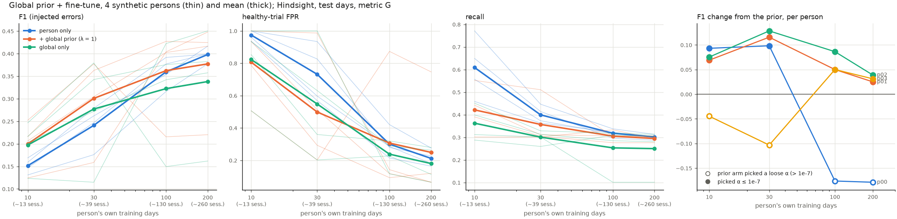
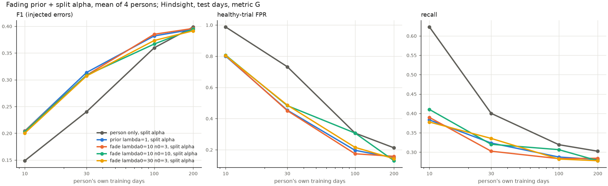
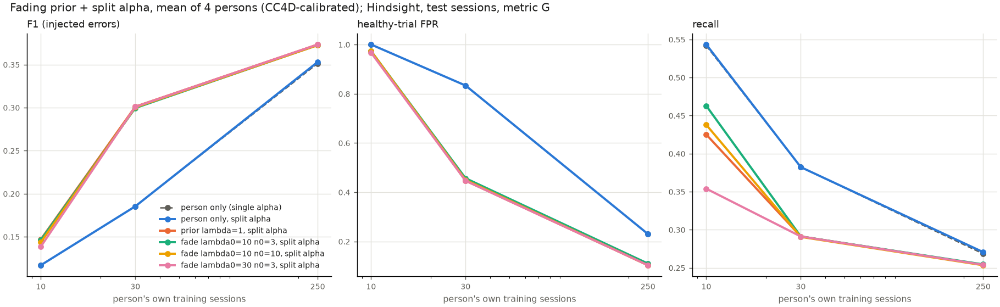
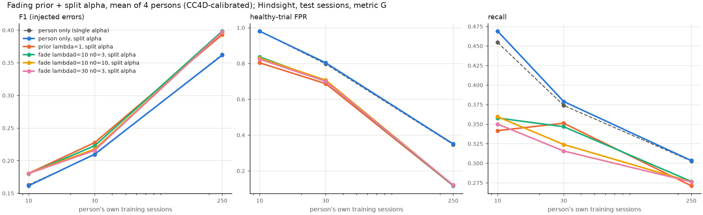

# Synthetic drift data from CaptainCook4D

The drift detector in [`next_steps.md`](next_steps.md) §2 needs streams where a person's normal
behaviour changes by a known amount at a known time. No public dataset has that, so this generator
builds it: multi-week, per-person streams of (verb, noun) actions in the EPIC-100 vocabulary, with
ground truth for onset, rate, size and the affected observable features.

It is a sanity and validity test, not a benchmark. Control matters more than realism, with one
exception: the output must be at the **logistics level** the HSMM is trained on (`take bowl`,
`pour water`), not the recipe-step level (`make roux`).

**Status (2026-10-16):** built end to end. All 31 conditions × 3 seeds × 8 persons are generated
under `dataset/processed/drift_synth/` (about 22k sessions, 470 MB, 70 s), and the sanity plots are
in (§8). Open for Jack: the duration scale a, β and the day-noise σ, and whether to lengthen waits
(sessions run 2.8 min against CC4D's 15.7). No detector has been run on the data.

**Revision (2026-10-17/18), regenerating overnight 2026-10-18** (`scripts/drift_synth/overnight_v2.sh`; §§5–9 below still describe the 18-recipe generator, whose outputs are archived under `dataset/processed/archive_18recipes/` and `runs/drift_synth/archive_18recipes/`):
- **8 recipes, not 18** (`recipes.yaml`): ≤ 14 steps, ≤ 10^2.5 orders, ≤ a third of tokens aliased.
  The 18-recipe sessions were 6× Breakfast's length (40 runs against 6), with 32 distinct pairs per
  recipe against 8, and no two sessions alike.
- **No healthy repetitions.** `fine_motor` repeats with P = max(0, θ − 0.5)·0.6, healthy
  θ0 ~ U(0, 0.4), and day noise never carries θ across the hinge (`knobs.keep_side_of_hinge`). A
  repeat follows a pause of ≥ 2 s so it shows as a second run; before, 52% merged into one run.
- **Two-sided flavour knobs with affinity**: `sour`, `sweet` (sugar, syrup), `salty` (salt only) and
  `fatty` (replaces `calorie_conscious`) (§2). Affinity is LLM-proposed in
  `configs/drift_synth/affinity.yaml` and waits on Jack's review (`reviewed: false`).

---

## 1. Design (settled; changes go through Jack)

1. **Recipe structure comes from CaptainCook4D (CC4D) task graphs.** The LLM never invents it.
2. **LLM for structure, code for randomness.** An LLM runs offline, once per recipe step, to expand
   the step into vocabulary tokens and propose knob variants. Ordering, inclusion, durations, noise
   and drift are all sampled in seeded code.
3. **Knobs are global and hand-defined** in `configs/drift_synth/knobs.yaml`. They act on **tags**,
   and tags are assigned once per vocabulary item, not per recipe.
4. **Closed vocabulary**: every emitted token is in `dataset/processed/epic/vocab.json`.
5. **Fetch and put-back logistics are inserted by code** (a kitchen-state pass), not by the LLM.
6. **Ground truth is defined in observable space**: per recipe, token marginals, bigrams and
   per-token durations. It never refers to HSMM latent states, and `cook_ad.drift_synth` imports
   nothing from `hsmm`, `detectors` or `eval` (a test enforces this).

## 2. Pipeline

| Stage | What | Randomness |
|---|---|---|
| 1 graphs | load and validate task graphs; LLM labels each step prep/cook/serve/cleanup | none (LLM, cached) |
| 2 tags | LLM proposes tags per vocab item (`sour`, `fat`, `sweet`, `salty` (salt only, by hand), `fine_motor`, `heat`, `cleaning`, `ingredient`, `tool`, `container`); Jack reviews | none |
| 3 expansion | LLM expands each step into core tokens (pass 1), then a lower-fat variant for steps whose tokens use a fat noun (pass 2), then one call per recipe for ≤ 2 sour sites; the flavour pass adds 1–2 sweet / salty / fatty insert sites per recipe (LLM) and an omit for each core token with the knob's nouns (code); validated, retried 3×, cached | none |
| 4 kitchen state | `take` before first use, `put` after last use, `wash`/`dry` after cleaning-relevant uses (rates from `tidy`); never for food made in the session (`kitchen_state.PREPARED`), and no put-back straight after the recipe's own `put` | seeded |
| 5 durations | log-normal per verb, (verb, noun) backoff below 20 samples, from EPIC-100; gap distribution; log-sd × 0.5 with the mean kept (`durations.narrowed`, `generator.yaml: durations.sigma_scale`) | seeded |
| 6 knobs | θ ∈ [0, 1] per knob drives variants, step order, logistics and duration scales | seeded |
| 7 nuisance | day-level θ noise (logit space), AR(1) speed, recognizer noise, recipe schedule and mix shift | seeded |
| 8 drift | θ(day) under none / sudden / incremental / gradual / recurring | seeded |
| 9 sample, export | one session = order → variants (additions spaced off their twins, `knobs.space_inserts`) → logistics → back-to-back identical actions merged into one → repetition → durations → noise | seeded |
| 10 ground truth | Monte Carlo observable statistics at θ0 and θ1; JS and W1 per recipe | seeded |

**Knobs.**

| knob | family | acts on |
|---|---|---|
| `sour` | preference (flavour) | adds or drops lemon, lime, vinegar |
| `sweet` | preference (flavour) | adds or drops sugar, syrup |
| `salty` | preference (flavour) | adds or drops salt |
| `fatty` | preference (flavour) | adds butter, oil, cheese, cream; or the LLM's lower-fat substitute/omit; fat-tagged durations × exp(0.7(θ − 0.5)) |
| `mise_en_place` | preference | step order: prep before cook |
| `tidy` | preference | put-back and wash/dry rates |
| `slow` | capability | every duration × exp(a(θ − 0.5)) |
| `fine_motor` | capability | duration and repetition probability of fine-motor-tagged verbs |

**Knob parameters** (`configs/drift_synth/knobs.yaml`): `tidy` puts back with P from 0.1 to
0.95 and washes tools and containers with P from 0 to 0.8, linear in θ. `slow` and `fine_motor` use
a = 1 (θ from 0 to 1 scales duration by 0.61 to 1.65). `fine_motor` repeats a token with
P = 0.6·max(0, θ − 0.5), after a pause of at least 2 s, and day noise never carries its θ across
0.5, so a healthy person (θ0 < 0.5) never repeats. `mise_en_place` uses β = 4. A capability
knob's high θ is the impaired end.

**Flavour knobs are two-sided around θ = 0.5** (`knobs.variant_prob`). Above it, the dish gets the
flavour added with P = 2(θ − 0.5)·affinity[recipe][knob], once per session, at one of its 1–2
insert sites picked uniformly (`knobs.pick_inserts`). Below it, each `substitute` or `omit` applies
with P = 2(0.5 − θ). At 0.5 the recipe is cooked as written. Affinity
(`configs/drift_synth/affinity.yaml`: rare 0.1, sometimes 0.4, common 1.0) is the chance that a
flavour-lover (θ = 1) changes this dish in a session, so lime in hot chocolate stays possible but
rare. Every addition is `add <ingredient>`, and so is the recipe's own salt. An addition that would land next to
the same action (more salt straight after the recipe's salt) moves to the end of the nearest step
where it does not, so it reads as a second addition, never as one action twice.

**No action appears twice in a row** in a clean stream except a `fine_motor` repetition. Besides
spacing additions: a put-back right after the recipe's own `put` of the same thing is dropped, and
any remaining identical pair is emitted as one event (`meta.merged`; in practice the burritos'
two sauces, which are both EPIC `sauce`, in about 57% of sessions). EPIC durations are narrowed
(log-sd × 0.5, same mean): their spread mixes people, objects and kitchens, and at full width one
person's `take banana` varied 13× between sessions. Removal ignores
affinity: an ingredient the recipe has can always be left out.

**Step order.** A softmax over the steps available at each point is *not* uniform over
topological orders. Each candidate is therefore weighted by the number of orders that complete it
(`graphs.linear_extension_counter`, a DP over order ideals), times exp(β(2θ − 1)·is_prep). At
θ = 0.5 the bias vanishes and the order is exactly uniform over the graph's topological orders.

**Drift regimes** (`schedule.theta_at`): `none`; `sudden` (θ1 from onset); `incremental` (linear
over `duration_days`; every duration knob is exp(a(θ − 0.5)), so linear in θ is linear in log
duration); `gradual` (each day θ1 with P = the same ramp, else θ0); `recurring` (θ1 and θ0
alternate in `period_days` blocks from onset). Day-level noise is then added in logit space
(`noise.theta_for_day`), and every duration and gap is multiplied by an AR(1) day speed.

**Recognizer noise** (`noise.recognizer_noise`). One categorical draw per clean event: delete,
swap the verb, swap the noun, or keep. Then, independently, a spurious token takes the event's
tail. Confusions come from the session's own tokens, so they stay in the vocabulary. Every rate is
per clean event, as configured.

**Random streams** (`sampler.rng_for`). A person's traits come from (seed, person), each day's draws
from (seed, person, day), and each session's from (seed, person, day, session). None of them
includes the condition. Conditions with the same seed therefore share every day before onset
(common random numbers), and a drift condition differs from `null` only through θ. Every random
choice draws a fixed number of numbers regardless of θ, so streams stay aligned as θ moves.

**Stage 3 details** (`expand.py`):
- The schemas enumerate the vocabulary, so a reply cannot be out of vocabulary.
- Validation rejects:
  - `take X` of a logistic noun;
  - an add/pour/sprinkle pair whose noun is not an ingredient (the destination, "add pan");
  - an ingredient the recipe does not name (the dish itself and generic food are allowed);
  - repeated pairs;
  - variants on the wrong tag or with indices out of range.
- CC4D's "Take X" steps expand to nothing, because Stage 4 inserts the take.
- Asked per step, the model added lemon *and* vinegar to almost every step, hot chocolate
  included. Asked once per recipe, it picks one or two sites or none.

## 3. Sources

- **Recipe structure**: `dataset/captaincook4d/task_graphs/` (github.com/CaptainCook4D/annotations).
  START and END are ordinary steps; an edge `[a, b]` means a precedes b. Loading strips the
  sentinels after checking they are the only source and sink.
- **Durations, gaps and few-shot exemplars**: EPIC-100 raw narrations
  (`dataset/epic_kitchens/annotations`, loaded by `data/parse_epic.py:load_narrations`). CC4D's
  advertised fine-grained action annotations are not public. Its finest public unit is the step
  (median ~30–40 s), which is above logistics level, so CC4D step and recording durations are used
  only to calibrate and check session length.
- **Vocabulary**: EPIC-100's 97 verb and 305 noun classes plus SIL (`stall`, `idle`). Verbs and
  nouns are separate classes.

## 4. Output

Per person, under `dataset/processed/drift_synth/<condition>/seed<k>/<person>/`:

- `sessions/<day>_<idx>.json`: timestamped string events, θ for the day, and the clean events
  before recognizer noise;
- `sequences.json`, `labels.json`, `vocab.json`: the loader format of every other corpus
  ([`data.md`](data.md) §1). These are EPIC ids at 0.5 s ticks with gaps as (`stall`, `idle`),
  `trial_id = <person>_d<day>_s<idx>`, and `recipe_label` set to the CC4D recipe;
- `ground_truth.json`: condition, regime, onset, duration, moving knobs, θ0, θ1, per-day θ and
  mix-shift parameters.

## 5. Findings so far

The full report is `runs/drift_synth/reports/precheck.md`, written by `scripts/drift_synth/precheck.py`.

- All 24 CC4D graphs validate. Their topological-order counts run from 6 (spiced hot chocolate) to
  1.6 × 10¹⁰ (broccoli stir fry), and each counts in milliseconds.
- **`mise_en_place` has little room.** The graphs already force nearly every prep step before the
  first cooking step. 18 of 24 recipes, including every stovetop dish, have no (prep, cook) pair the
  knob could reorder. The six that do are all in the proposal.
- **EPIC verbs are coarse**: whisk, stir and beat are all `mix`; chop, slice and trim are all `cut`.
  There is no `wipe` (it is an instance of `wash`). `pepper` covers both bell and black pepper, and
  `sauce` covers soy sauce, salsa, sriracha, mayonnaise and marinara.
- Items with no EPIC noun: dental floss (pinwheels), frosting and cupcake liners (mug cake), the
  spiralizer (zoodles).
- **Phases** (`configs/drift_synth/phases/`, review copy `runs/drift_synth/reports/phases.md`):
  gemma3 needed two explicit rules. Adding to a pan already on the heat is cook. A recipe that never
  heats anything has no cook steps.
- **Tags** (`runs/drift_synth/reports/tags_summary.md`, with a list of likely errors): the proposal
  over-tags. Knife, spoon and hand come back as ingredients, whisk and dishwasher as heat, and 34
  verbs as fine-motor. Sour is only lemon, lime, vinegar and yoghurt.
- **EPIC durations** (`dataset/drift_synth/durations_epic.json`): take and put about 1.4 s, cut
  5.5 s, mix 7.6 s; 35% of gaps are zero. EPIC narrations do not cover long waits (microwaving,
  simmering), so sessions will be shorter than CC4D recordings (median 15 min) unless expansions
  emit `wait` tokens.
- **Expansions** (`configs/drift_synth/expansions/`): 257 steps, 0 skipped. 26 calorie variants,
  all `omit` (the model never proposed a lower-fat substitute). 21 sour inserts, some odd: lime in
  hot chocolate, lemon in pancake batter. The review sample is a seeded 10%.
- **First generation** (`null`, seed 0): 719 sessions over 8 persons and 70 days, generated in
  under a second. The median session is 2.9 min (p10–p90 2.2–4.5) against CC4D's ~15 min. EPIC's
  `wait` narrations are a few seconds long, so waiting is nearly free.
- **Approved set** (18 recipes, every knob covered by ≥ 6): scrambled eggs, herb omelet, tomato
  mozzarella salad, caprese bruschetta, cucumber raita, butter corn cup, sauteed mushrooms,
  broccoli stir fry, zoodles, pan-fried tofu, tomato chutney, microwave egg sandwich, microwave
  French toast, breakfast burritos, spiced hot chocolate, cheese pimiento, banana pancakes, coffee.

## 6. Conditions

`configs/drift_synth/conditions.yaml`, expanded by `scripts/drift_synth/generate.py:conditions`
into 37 conditions (31 before the 2026-10-17 knob revision) × 3 seeds × 8 persons × 70 days, with onset at day 28 and ramps of 21 days:

- `null` and `mix_shift_only`;
- every knob × {sudden, incremental, gradual}, with |Δθ| = 0.4 (`fine_motor` + 0.6, so every healthy θ0 < 0.4 ends above its 0.5 repetition hinge);
- `pref_plus_capability` (sour and slow together);
- `sour` and `slow` sweeps at |Δθ| ∈ {0.05, 0.1, 0.2, 0.3, 0.45}, sudden.

θ0 ~ U(0.25, 0.75) per knob. θ1 moves up if that fits in [0, 1], otherwise down.

## 7. Tests

`tests/test_drift_synth_generator.py` runs on a toy world (`tests/_drift_fixtures.py`: two
recipes, hand-written expansions and tags, the real knobs) and covers the spec's nine tests:

1. vocab compliance;
2. sampled orders are topological;
3. byte-identical exports;
4. knob isolation: unlinked counts within MC noise (Bonferroni z), unlinked durations (KS), and `mise_en_place` moving bigrams only;
5. null equivalence at α = 0.01 after Bonferroni;
6. a monotone dose-response for `sour` (marginal JS) and `slow` (mean W1);
7. noise rates within 10% on 10k events;
8. uniform order at θ = 0.5 (χ²) on a graph where a naive softmax is not uniform;
9. `sudden` switches exactly at onset, and `gradual` tracks its ramp within 0.04 per week.

It also checks that pre-onset days are identical between `null` and a drift condition.

## 8. Sanity results

`scripts/drift_synth/sanity_plots.py` writes to `runs/drift_synth/reports/sanity/`. The numbers
below are means over the 18 recipes, 150 clean Monte Carlo sessions per recipe and θ, from
θ = 0.5 on every knob. "MC noise" is the same comparison against a rerun at θ = 0.5 with
another seed.

**Isolation** (`isolation.png`): the change at |Δθ| = 0.45 as a multiple of MC noise.

| knob | core-token marginals | take/put/wash marginals | bigrams | log durations |
|---|---|---|---|---|
| sour | 10.8× | 5.8× | 2.4× | 1.0× |
| calorie_conscious | 41.3× | 21.5× | 4.6× | 1.1× |
| mise_en_place | 1.1× | 1.0× | 3.9× | 1.0× |
| tidy | 1.0× | 11.6× | 6.0× | 1.0× |
| slow | 1.0× | 1.0× | 1.0× | 4.0× |
| fine_motor | 2.1× | 1.0× | 1.4× | 2.0× |

Each knob moves the feature group it targets and leaves the rest at noise. The off-target
entries are expected:

- `sour` and `calorie` move take/put/wash because an inserted or omitted ingredient brings or loses
  its own logistics. Any change in tokens also moves bigrams.
- `fine_motor` moves marginals through its repetitions.
- `calorie`'s fat-token speed-up is too small to see in durations (1.1×).
- `mise_en_place` is the weakest knob (3.9× on bigrams), as the pre-check predicted.

**Dose-response** (`dose_response.png`): monotone in |Δθ| for every knob on its own feature. At
|Δθ| ≤ 0.05 nothing is distinguishable from noise. `slow` reaches W1 = 0.44 against 0.11 noise,
while `sour` at 0.45 is 7× noise on marginal JS.

**Lengths** (`lengths.png`): the median session is 2.8 min, against 5.8 for EPIC sessions (2–15 min
band) and 15.7 for CC4D normal recordings. The median action is 2.2 s against EPIC's 1.6 s, with
more synthetic actions under 0.5 s (recognizer inserts and jitter). Sessions are short because EPIC
`wait` narrations are a few seconds long; waiting is not modelled.

**Granularity** (`examples.md`): synthetic sessions read at EPIC's level ("take onion, cut onion,
add onion, put onion"). Recognizer noise produces the odd pair ("turn-on garlic").

## 9. Does the anomaly detector work on this data?

`scripts/eval/eval_synth_ad.py`, results in `runs/drift_synth/eval_synth_ad{,_clean}.json`.

**Setup.**
- **The person:** seed 0, person 6 (θ0 slow = fine_motor = 0.41, 7 recipes), cooking for 320 days.
- **The model:** fitted on days 0–199 (265 sessions) with the four-stage dish preset (`configs/drift_synth/hsmm.yaml`: K = 128, recipe = the CC4D recipe).
- **Operating points:** best G-F1 on the five injected error types over days 200–259.
- **Test days 260–319:**
  - the injectors on the normal sessions;
  - the same sessions re-sampled with `slow` or `fine_motor` raised by 0.2, 0.4 or 0.55. Common random numbers make each anomalous trial differ from its normal twin only in θ.
- **Two versions of the person:** with the generator's recognizer noise, and without it (`--noise off`).

**Injected errors, test days, metric G** (78 trials per group; null F1 0.052–0.055):

| noise | arm | precision | recall | F1 | alarms / 10 min | run FPR | healthy-trial FPR | subst. | aband. | omission | transp. | repet. |
|---|---|---|---|---|---|---|---|---|---|---|---|---|
| off | hindsight (α 1e-10) | 0.374 | 0.338 | 0.355 | 2.70 | 0.017 | 0.449 | 0.99 | 0.08 | 0.22 | 0.37 | 0.01 |
| off | live L=0 (α 1e-7, κ 0.9) | 0.370 | 0.344 | 0.357 | 2.80 | 0.018 | 0.449 | 0.99 | 0.08 | 0.22 | 0.38 | 0.03 |
| on | hindsight (α 1e-10) | 0.142 | 0.350 | 0.202 | 10.41 | 0.059 | 0.897 | 0.99 | 0.23 | 0.24 | 0.21 | 0.22 |
| on | live L=0 (α 1e-10, κ 0.9) | 0.144 | 0.350 | 0.204 | 10.22 | 0.058 | 0.910 | 0.99 | 0.23 | 0.22 | 0.22 | 0.23 |

**Capability pools vs their normal twins** (metric G alarm counting: one alarm per flagged run;
hindsight shown, live L=0 agrees within 0.1):

| noise | pool | min / trial | alarms / 10 min | trials with alarm | more alarms than twin | fewer | Δ alarms / trial | repetition recall (G) |
|---|---|---|---|---|---|---|---|---|
| off | healthy twins | 2.7 | 2.70 | 0.45 | | | | |
| off | slow +0.2 / +0.4 / +0.55 | 3.3 / 4.0 / 4.7 | 2.22 / 1.56 / 1.34 | 0.44 / 0.38 / 0.41 | 0.05 / 0.06 / 0.06 | 0.06 / 0.14 / 0.14 | +0.00 / −0.10 / −0.10 | |
| off | fine_motor +0.2 / +0.4 / +0.55 | 3.0 / 3.4 / 3.8 | 2.30 / 2.21 / 2.03 | 0.44 / 0.46 / 0.49 | 0.08 / 0.10 / 0.15 | 0.13 / 0.09 / 0.13 | −0.04 / +0.03 / +0.04 | 0.04 / 0.06 / 0.06 |
| on | healthy twins | 2.7 | 10.41 | 0.90 | | | | |
| on | slow +0.55 | 4.7 | 6.19 | 0.87 | 0.29 | 0.24 | +0.08 | |
| on | fine_motor +0.55 | 3.8 | 7.94 | 0.92 | 0.38 | 0.29 | +0.21 | 0.22 |

**What it says.**

- **Local errors are partly detected.** Substitution is caught (0.99). Transposition (0.37) and
  omission (0.22) are about Breakfast's level for omission and below it for transposition.
  Abandonment and repetition are nearly invisible without noise. With noise, recall on those two
  rises to ~0.22 only because the alarms are everywhere (healthy-trial FPR 0.90).
- **The healthy floor is structural.**
  - The operating point lands at the grid's strictest α in both runs, and the healthy alarms are mostly `s_transition` / `s_recipe_transition`.
  - Step orders are sampled uniformly over up to 10¹⁰ topological orders, so a held-out session often contains a transition never seen in 265 training sessions, and an unseen transition sits on the floor at any α.
  - Recognizer noise then adds `s_emit` flags on swapped tokens: 4× the alarm rate.
- **Capability decline is invisible to the per-trial detector at every level, with or without
  noise.** Even at 1.73× slower, a slowed trial raises the same number of alarms as its twin:
  - `s_temporal` fires more (raw flags 26 → 88), but on runs that are already alarmed.
  - A 1.7× slowdown is 0.55 in log duration, under one standard deviation of EPIC's per-verb spread (σ ≈ 0.65–1.0).
  - The `fine_motor` repetitions are normal for this person (at θ0 = 0.41, 14% of fine-motor tokens already repeat), so the model has learned them.

  This is a property of per-trial anomaly detection, not a bug: a whole-person shift is small in
  any one trial and visible only in aggregate. It is the case for the drift detector
  ([`next_steps.md`](next_steps.md) §2).

### 9.1 Lowering the healthy alarm floor

Three levers, one at a time and combined:

- **Training days:** 200 → 600. Validation and test are always the 60 + 60 days after training.
- **A routine (habit):** each person has a preferred topological order per recipe, and every
  available step is down-weighted by exp(−habit × its rank in that order): a sequential
  Mallows-style concentration. At habit = 0 the draws and the rng stream are unchanged, so every
  dataset in §6 is identical (`generator.yaml: person.habit`, `knobs.sample_topological_order`).
  Raising β would not do this: β only biases prep against cook by the person's `mise_en_place`
  θ, and at θ ≈ 0.5 the order stays uniform.
- **Recognizer noise scale:** × 0.5.

All runs use the same person, Hindsight at its validation-picked α; live L=0 agrees within 0.02 F1.

**Injected errors, test days, metric G:**

| setting | F1 | precision | recall | alarms / 10 min | run FPR | healthy-trial FPR | subst. | aband. | omission | transp. | repet. |
|---|---|---|---|---|---|---|---|---|---|---|---|
| baseline (200 days, habit 0, noise × 1) | 0.202 | 0.142 | 0.350 | 10.41 | 0.059 | 0.897 | 0.99 | 0.23 | 0.24 | 0.21 | 0.22 |
| 600 training days | 0.238 | 0.240 | 0.236 | 3.34 | 0.022 | 0.512 | 0.94 | 0.04 | 0.12 | 0.15 | 0.02 |
| habit 2 | 0.214 | 0.154 | 0.346 | 9.02 | 0.052 | 0.859 | 0.97 | 0.17 | 0.18 | 0.28 | 0.19 |
| noise × 0.5 | 0.263 | 0.202 | 0.378 | 7.17 | 0.043 | 0.782 | 0.99 | 0.19 | 0.19 | 0.41 | 0.08 |
| all three | 0.290 | 0.290 | 0.291 | 3.27 | 0.021 | 0.561 | 0.98 | 0.05 | 0.12 | 0.26 | 0.09 |
| noise × 0 (200 days, habit 0) | 0.355 | 0.374 | 0.338 | 2.70 | 0.017 | 0.449 | 0.99 | 0.08 | 0.22 | 0.37 | 0.01 |

**Where the healthy alarms come from** (share of raw flags on the healthy twins):

| setting | `s_emit` + `s_verb` + `s_noun` | `s_transition` | `s_recipe_transition` | `s_temporal` |
|---|---|---|---|---|
| baseline | 0.42 | 0.26 | 0.26 | 0.07 |
| 600 training days | 0.05 | 0.44 | 0.43 | 0.07 |
| habit 2 | 0.45 | 0.20 | 0.20 | 0.15 |
| noise × 0.5 | 0.56 | 0.22 | 0.22 | 0.01 |
| all three | 0.25 | 0.35 | 0.34 | 0.05 |
| noise × 0 | 0.02 | 0.39 | 0.39 | 0.19 |

**What it says.**

- **Noise is the biggest lever, then data.**
  - Removing noise halves healthy-trial FPR (0.90 → 0.45) and doubles F1.
  - Tripling the training data takes FPR to 0.51, mostly by learning the noise. Emission flags fall from 42% to 5% of the floor.
  - But that also costs recall on the structural errors: abandonment 0.23 → 0.04, repetition 0.22 → 0.02. The model has learned that a swapped or extra token is ordinary.
- **Habit 2 barely moves the floor** (0.90 → 0.86). Transition alarms on noisy data come
  mostly from noise-made transitions (an inserted token creates two new bigrams), not from the
  step order.
- **The floor that remains is transitions.** With noise off or enough data, `s_transition`
  is 70–80% of healthy alarms. No setting gets the healthy-trial FPR below ~0.45, and the picked
  α stays at the grid's strictest value.
- **`s_recipe_transition` duplicates `s_transition` on this data.** It fires on the same runs at
  every setting (dish given, 7 recipes), so it adds no information here.
- **Capability decline stays invisible in every setting.** Δ alarms vs twin is within ±0.3 at
  slow or fine_motor +0.55, so §9's verdict holds.

### 9.2 A global prior from a simulated population

`scripts/eval/eval_synth_prior.py`, `hsmm/train/global_prior.py`. Noise off throughout.

**The population:** 60 people (seed 1000, never test subjects), 30 days each, 2,336 sessions.
- Preference knobs θ0 ~ U(0.05, 0.95), capability knobs ~ U(0.4, 0.6), habit ~ U(0, 1).
- Their tick streams are run-length counted per recipe into first-run and run-to-run transition counts, keyed by (verb, noun). States are pairs, so these counts are the prior with no population EM, and they project onto any person's state inventory.
- One prior serves every person model.

**The fine-tune:** the person's four-stage dish fit (§9), then post-fit, like `smoothing.backoff_counts`:
- Each transition and init row gets λ × the population's row for that recipe and pair. λ is in pseudocounts per row: λ = 10 is the population worth about 10 of the person's own observations of what follows that action.
- Cells are first lifted to count 1, so under the MAP mode a cell the person never produced is worth exactly λ·P_global.
- λ = 0 is the person-only model bit for bit. A transition nobody produced stays on the floor.
- "Global only" drops the person's own init and transition counts.

**The test persons:** seed 0, persons 0–3, habit 2, capability U(0.4, 0.6), 1.3 sessions a day.
Each is trained on its first 10, 30, 100 or 200 days, validated on days 200–259 (injected errors,
α picked by G-F1) and tested on days 260–319. Every arm and N uses the same pools, placed by the
person's N = 200 model. The tables in this section count training size in days (mean 13 / 38 / 132 / 261
sessions). `eval_synth_prior.py` now counts **sessions** instead, in cooking order: the first
10 / 30 / 100 / 250 sessions train, sessions 250–324 validate and 325–399 test, so every person has
the same 75 + 75 held-out sessions. The day-based numbers below were measured at f590c55.

**Mean over the 4 persons, Hindsight, test days, metric G:**

| train days (≈ sessions) | arm | F1 | precision | recall | alarms / 10 min | healthy-trial FPR |
|---|---|---|---|---|---|---|
| 10 (13) | person only | 0.152 | 0.088 | 0.609 | 29.46 | 0.97 |
| 10 | + prior λ = 1 | **0.200** | 0.143 | 0.422 | 15.04 | 0.81 |
| 10 | global only | 0.197 | 0.140 | 0.363 | 10.98 | 0.82 |
| 30 (40) | person only | 0.241 | 0.177 | 0.400 | 8.90 | 0.73 |
| 30 | + prior λ = 1 | **0.301** | 0.334 | 0.357 | 6.95 | 0.50 |
| 30 | global only | 0.277 | 0.296 | 0.301 | 5.61 | 0.55 |
| 100 (130) | person only | 0.360 | 0.418 | 0.318 | 2.00 | 0.30 |
| 100 | + prior λ = 1 | 0.362 | 0.550 | 0.305 | 2.23 | 0.31 |
| 100 | global only | 0.322 | 0.460 | 0.253 | 1.24 | 0.24 |
| 200 (260) | person only | **0.398** | 0.587 | 0.302 | 0.97 | 0.21 |
| 200 | + prior λ = 1 | 0.377 | 0.643 | 0.295 | 1.62 | 0.25 |
| 200 | global only | 0.338 | 0.562 | 0.250 | 0.89 | 0.18 |

λ = 3, 10, 30 and 100 are within 0.01 F1 of λ = 1 at 10–30 days, and no better than it later
(`runs/drift_synth/eval_synth_prior_p0*.json`).

(`./py scripts/eval/eval_synth_prior.py --stage plot`)

**F1 change from the prior (λ = 1), per person:**

| train days | p00 | p01 | p02 | p03 |
|---|---|---|---|---|
| 10 | +0.09 | +0.07 | +0.08 | −0.05 |
| 30 | +0.10 | +0.12 | +0.13 | −0.10 |
| 100 | −0.17 | +0.05 | +0.09 | +0.05 |
| 200 | −0.18 | +0.03 | +0.04 | +0.03 |

**What it says.**

- **The prior is a clear win at cold start.** At 10–30 days mean F1 rises by 0.05–0.06 and the
  healthy-trial FPR falls from 0.73 to 0.50. With 100+ days it is a wash on average.
- **λ hardly matters,** because at the strict α the detector asks only whether a transition is
  possible: any prior mass turns "never seen" into "allowed". At α = 1e-10 on p00 (200 days)
  the prior cuts the healthy-trial FPR from 0.16 to 0.03. It also removes every
  transition-channel catch of omission (29 → 0) and transposition (60 → 0): the person-only
  model was detecting them as "a transition this person never made".
- **Every loss is an operating-point failure.** In all four losing cells (p00 at 100 and 200 days,
  p03 at 10 and 30) the prior arm's validation pick jumped from α ≤ 1e-7 to α = 0.015–0.05,
  where alarms explode. Where the pick stayed strict, the prior helped in 12 of 12 cells.
  - **A split α** (transition channels picked separately from the rest, `harness.hindsight_split_grid`) recovers part of p00's loss: F1 0.22 → 0.29–0.30 at 100–200 days, still below person-only 0.40.
  - **Next:** a prior that fades with the person's own row count, paired with the split α.
- **Why persons differ:** p01 and p02 cook high-freedom recipes (stir fry 1.6×10¹⁰ orders, scrambled eggs 3.6×10⁶); p00 and p03 cook constrained ones. At 30 days, test transitions the person had never produced are 13% for p01/p02 and 6–7% for p00/p03. At 200 days they are 0.6–1.4% for all four, and 0.03–0.15% are unseen by the population too. This explains part of the pattern, but not p03's early loss.

**Split α and a fading prior** (`--stage eval-split`, the same fits and pools). Every arm picks
the transition channels' α separately from the other channels' on validation. A fading prior
gives a row the person has left n times λ₀ / (1 + n / n₀). Mean over the 4 persons, Hindsight,
test days, metric G (F1 / healthy-trial FPR):

| train days | person only | prior λ = 1 | fade (λ₀ 10, n₀ 3) | fade (10, 10) | fade (30, 3) |
|---|---|---|---|---|---|
| 10 | 0.149 / 0.99 | **0.204** / 0.80 | **0.204** / 0.80 | 0.203 / 0.81 | 0.200 / 0.80 |
| 30 | 0.240 / 0.73 | **0.314** / 0.45 | 0.308 / 0.45 | 0.308 / 0.48 | 0.307 / 0.49 |
| 100 | 0.360 / 0.31 | 0.382 / 0.20 | **0.385** / 0.17 | 0.367 / 0.31 | 0.373 / 0.22 |
| 200 | **0.399** / 0.21 | 0.394 / 0.15 | 0.396 / 0.16 | 0.395 / 0.13 | 0.392 / 0.14 |

- **The split α is what helps.** With it, the fixed prior's loss at 100–200 days becomes a gain
  or a tie (single α 0.362 / 0.377 → split 0.382 / 0.394), and its healthy-trial FPR stays below
  person-only at every size.
- **Fading adds nothing measurable:** every setting is within 0.02 F1 of the fixed prior.
- **p00 still loses at 100–200 days** (person-only 0.40, any prior 0.29–0.30). Even faded, a
  transition p00 never made goes from ~1e-12 to ~1e-3, and it only flags again at a loose
  transition α (0.015) where ordinary rare transitions flag too. For p00, "never made by this
  person" was a nearly clean error signal (about 1% of healthy test transitions are new to it).
  **p03 loses at 10–30 days** (0.26 → 0.19–0.21), where its picks go to α_trans 0.05–0.2.
- **No prior setting is best for every person.** Which one is can be measured on the person's
  own validation data.

### 9.3 Calibration against CaptainCook4D

`scripts/drift_synth/calibrate_cc4d.py` writes `runs/drift_synth/reports/cc4d_calibration.{md,json}`.
The real data are CC4D recordings with no Order Error or Missing Step tag: 5–13 per recipe.

- **Order variety matches uniform rollouts.** At equal sample size, the share of distinct orders is
  real 0.57–1.00 against generator 0.61–1.00. Real orders are about 25% closer to their medoid than
  uniform ones (normalized Kendall).
- **Habit:** real within-person distance 0.086 (91 pairs), between-person 0.104 (477 pairs). Habit 2
  gives 0.022 / 0.099, and the best grid fit is habit ≈ 0–0.25. Set aside for now: 2–3 lab repeats
  per person make the within-person figure mostly noise.
- **Real recordings break the task graphs.** For sautéed mushrooms 0 of 7 normal recordings follow its
  edges, tomato chutney 1 of 5, pan-fried tofu 5 of 9. People interleave and overlap steps (by
  annotated start time), which the graphs, and so the generator, cannot produce.
- **Durations are 4–5× short on every kind of step, not only waits.** The median recording has
  716 s of step time against 169 s for a synthetic session; steps with a `wait` token are 4.0×
  short, the rest 4.6×. The largest gaps are "cook for N minutes" steps the expansion gave no
  `wait` (pan-fried tofu, "cook 5 to 6 minutes": 327 s real, 8 s generated).
  - **Step-time calibration** (built, off by default): `calibrate_cc4d.py --write-scales` writes
    `configs/drift_synth/step_time_scale.json`, where each step's scale is the CC4D median step
    time divided by the uncalibrated generator's median.
    - Scales run from 2.8× (banana pancakes) to 9.1× (sautéed mushrooms), with a 4.15× global median.
    - The sampler multiplies each recipe action's duration and following gap by its step's scale. Take/put/wash keep their EPIC time (median 1.7 s, p90 3.4 s), since fetching takes as long wherever it happens. Single events are capped at 600 s.
    - Since 2026-10-18 the scale is (CC4D median step time − the step's mean take/put/wash time) / the mean time of its own actions and gaps (`calibrate_cc4d.py`, `core_scale`). Before, logistics were scaled with their step (`sampler.step_owners`), so a `take salt` next to a 14× step lasted 36 s. On the 8 recipes the calibrated session medians are within 6% of the summed CC4D step medians (190–907 s); global median scale 4.51.
    - Calibrated sessions: median 807 s against CC4D's 716 s of step time.
    - Enable with `generator.yaml: durations.step_scale` and `max_event_s`.
  - **The calibrated rerun** (`scripts/drift_synth/overnight_cal.sh`, `eval_synth_prior.py --variant cal`)
    uses 1 s ticks, d_max 300 (`configs/drift_synth/hsmm_cal.yaml`), training sizes 10 / 30 / 250
    sessions and 20 soft-EM iterations, to fit in a night. After iteration 20 the objective moved less
    than 0.2% in 13 of 16 uncalibrated fits. It ran in 4 h 47 min on 2026-10-17.

**Calibrated rerun, mean over the 4 persons, Hindsight, test sessions 325–399, metric G (F1 / healthy-trial FPR):**

| train sessions | person only | prior λ = 1 (split α) | fade (λ₀ 10, n₀ 3) |
|---|---|---|---|
| 10 | 0.117 / 1.00 | **0.147** / 0.97 | 0.146 / 0.97 |
| 30 | 0.185 / 0.83 | **0.301** / 0.45 | 0.300 / 0.46 |
| 250 | 0.353 / 0.23 | **0.373** / 0.10 | **0.373** / 0.11 |

- **On calibrated data the prior helps every person at 30 and 250 sessions** (per-person F1 gains of
  0.01–0.15). That includes p00, which lost 0.10 with any prior on the uncalibrated data.
- **At 10 sessions p00 and p03 tie or lose** (0.118 → 0.119, 0.120 → 0.112). In both cells validation
  picked a loose transition α (0.07, 0.1); p01 and p02 gain 0.06.
- **Fading is again within 0.01 of the fixed prior everywhere, and split α is within 0.015 of a
  single α.** The single α already lands on α_trans 1e-5 to 1e-4, not the 1e-10 of the uncalibrated run.
- **Recall is almost all substitution** (0.98). Abandonment is 0.00–0.05, omission 0.07–0.11 and
  repetition 0.02–0.06 from 30 sessions on. The prior trades about 0.02 recall for half the healthy FPR.
- Not comparable cell for cell with the uncalibrated tables: tick length, event durations, soft-EM
  iterations (20 against 60) and the split unit all changed. Alarms per 10 minutes fall mainly
  because calibrated sessions are about 5 times longer.

### 9.4 Rerun on the revised generator (2026-10-18)

The same calibrated experiment (`overnight_v2.sh` → `overnight_cal.sh`, 2 h) on the 8-recipe
generator: no healthy repeats, two-sided flavour knobs with affinity, narrower durations,
unscaled logistics. Same protocol, but new people and recipes, so it is not paired cell for cell
with §9.3.

**Mean over the 4 persons, Hindsight, test sessions 325–399, metric G (F1 / healthy-trial FPR), split α:**

| train sessions | person only | prior λ = 1 | fade (λ₀ 10, n₀ 3) | §9.3 person only → prior |
|---|---|---|---|---|
| 10 | 0.161 / 0.98 | **0.180** / 0.80 | **0.180** / 0.84 | 0.117 → 0.147 |
| 30 | 0.210 / 0.80 | **0.228** / 0.69 | 0.223 / 0.70 | 0.185 → 0.301 |
| 250 | 0.362 / 0.35 | 0.393 / 0.12 | **0.398** / 0.12 | 0.353 → 0.373 |

- The prior still wins on average at every size, and at 250 sessions for every person (+0.01 to +0.05). At 10 and 30 sessions it loses for one person each (p01 at 10, p00 and p03 at 30).
- Recall at 250 sessions (prior): substitution 0.97, transposition 0.24, omission 0.09, abandonment 0.04, repetition 0.04. Removing healthy repeats did not make injected repetitions visible.
- The 30-session gain shrank (+0.12 → +0.02), while cold start (10) and 250 improved for both arms. Fading again ties the fixed prior.

### 9.5 Why structural errors are missed: most are not errors

`scripts/eval/diagnose_synth_injections.py` rebuilds each person's test pool (calibrated, N = 250,
prior λ = 1, the operating point §9.4 picked) and asks of every injected trial: is it outside what
this person ever does? The reference is ~3,400 more healthy sessions of the same person (days the
pool never saw). Three oracles: a run bigram never seen; a per-recipe run count outside its healthy
range; a run duration outside the healthy 0.2–99.8% range. "Hit" = an HSMM alarm in the span or
≤ 10 ticks after it (close to metric G recall).

**All 4 persons, 75 test trials each per type:**

| type | target is a gap | target is take/put/wash | truly anomalous | HSMM hit | hit, anomalous only | hit, not anomalous |
|---|---|---|---|---|---|---|
| substitution | 0.35 | 0.30 | 1.00 | 0.97 | 0.97 | — |
| abandonment | 0.30 | 0.31 | 0.39 | 0.04 | 0.09 | 0.01 |
| omission | 0.40 | 0.27 | 0.40 | 0.09 | 0.19 | 0.02 |
| transposition | 0.73* | 0.63* | 0.36 | 0.25 | 0.69 | 0.00 |
| repetition | 0.35 | 0.35 | 0.20 | 0.04 | 0.13 | 0.02 |

\* either of the two swapped segments.

- **Two thirds of the structural injections are not anomalies.** The injectors (built for Breakfast, whose segments are steps) pick a segment of the model's segmentation uniformly. Here 30–40% are idle gaps: removing, shortening, copying or moving a pause is normal. Another ~30% are take/put/wash: put-backs are optional (`tidy`), and a 2-tick fetch cannot be visibly truncated. A repetition copies its segment in place, so the copy merges into one longer run, and only 20% leave the healthy duration range.
- **Where they are anomalous, a first-order model cannot see most omissions.** 82% of omitted recipe actions are anomalous, but only 21% leave an unseen bigram. 74% are visible only by counting (an action that is always there is missing). The HSMM catches 17%.
- **Durations are not too smooth overall but have fat left tails** (`scripts/eval/diagnose_synth_durations.py`, p00). The fitted negative binomial matches each cell's spread (sd ratio median 1.00, p90 1.34). But it puts a median 9.8% of mass below the cell's empirical 1% point (3.6% for recipe actions; 41% for 2-tick take/put/wash). So a run cut to 12.5% of its median reaches P ≤ 0.001 in only 56% of recipe-action cells and in no logistics or gap cell.
- **Transposition and substitution work** where the error is real (0.69, 0.97).

### 9.6 Re-scored on real anomalies only

The §9.4 models and protocol, with every injected trial the §9.5 oracle (local checks) does not
confirm dropped from both validation (where α is picked) and test
(`eval_synth_prior.py --variant cal --pool real`). Structural groups shrink to 11–33 trials per
person and split, substitution stays at ~75, so the pool is about half substitutions, which are
easy. Read the F1 with that in mind, and the per-type recalls as the main result.

**Mean over 4 persons, Hindsight, test sessions, metric G (split α):**

| train sessions | arm | F1 | precision | recall | healthy-trial FPR | subst. | aband. | omission | transp. | repet. |
|---|---|---|---|---|---|---|---|---|---|---|
| 10 | person only | 0.199 | 0.120 | 0.578 | 0.98 | 0.76 | 0.36 | 0.39 | 0.66 | 0.19 |
| 10 | prior λ = 1 | 0.273 | 0.204 | 0.501 | 0.77 | 0.73 | 0.23 | 0.22 | 0.58 | 0.18 |
| 30 | person only | 0.305 | 0.209 | 0.610 | 0.80 | 0.84 | 0.29 | 0.36 | 0.71 | 0.16 |
| 30 | prior λ = 1 | 0.359 | 0.285 | 0.529 | 0.64 | 0.79 | 0.35 | 0.22 | 0.52 | 0.13 |
| 250 | person only | 0.619 | 0.635 | 0.608 | 0.28 | 1.00 | 0.08 | 0.23 | 0.69 | 0.13 |
| 250 | prior λ = 1 | **0.687** | 0.873 | 0.567 | **0.05** | 0.96 | 0.01 | 0.19 | 0.67 | 0.05 |

On the full pool (§9.4) the same models scored 0.393 at 250 sessions. Transposition is
detected (0.67–0.71) once the gap and take/put/wash swaps are gone. Omission (0.19–0.23),
abandonment (0.01–0.08) and repetition (0.05–0.13) stay low on real ones.

### 9.7 Step-level injections, and channels that see them

**Step-level injectors** (`drift_synth/inject.py`, `eval_synth_prior.py --pool gen`). They edit one
real error into a held-out session's clean events, using the generator's step labels. Every other
event keeps its duration and gap. The table below defines each error and its metric G span:

| error | edit | span |
|---|---|---|
| omission | all recipe actions of one step dropped (its fetches stay) | from the step's old place to the next step's first action |
| transposition | a step, with its fetches and put-backs, moved to before a step it depends on in the task graph | the moved step's first action, and the jumped step's first action |
| repetition | a step's actions done again after the next step | the repeat's first action |
| abandonment | an action of ≥ 8 s cut to 5–20% (≥ 1.5 s) and the rest of its step skipped | the cut action |
| substitution | an action's verb or noun replaced by one the person never uses in that recipe | that action |

The §9.5 oracle confirms 71–84% of abandonments, 80–93% of omissions and 84–95% of repetitions,
and 100% of substitutions. Transpositions are 27–60% by its local checks and 89–97% with an order
check (an action first seen before one it never precedes in healthy data).

**Why the HSMM missed them: idle gaps.** Two actions in three are separated by an idle run, so
the model's transitions go A → idle → B. Every action follows idle somewhere, so a repeated, moved
or skipped step leaves no unusual transition. A bigram over non-idle runs alone sees 91–95% of
omissions, all transpositions and 87–91% of repetitions, at 3–8% of healthy sessions. Breakfast
has no gaps between actions, which is why this never showed there.

**Three add-on channels** for the hindsight HSMM, each fitted from the model's own Viterbi decodes of
the person's training sessions:
- `skip_idle.SkipIdleTransitions`: P(next non-idle state | previous non-idle state), per recipe.
- `count_channel.CountChannel`: a state the recipe almost always visits that is missing, flagged where its usual successor starts; or a visit beyond the training counts.
- `empirical_duration.EmpiricalShortDuration`: P(a segment this short) from the training durations themselves, instead of the negative binomial's fat left tail.

Their p-values are smoothed frequencies. The first two share one extra axis of the validation
grid, and the duration channel has its own. Level 0 (off) is always available, so validation
can decline them.

**Mean over 4 persons, step-level pools, Hindsight, test sessions, metric G (F1 / healthy-trial FPR):**

| train sessions | arm | HSMM (split α) | + skip-idle + count | + empirical duration |
|---|---|---|---|---|
| 10 | person only | 0.178 / 0.99 | 0.219 / 0.99 | 0.220 / 0.99 |
| 10 | prior λ = 1 | 0.218 / 0.79 | 0.291 / 0.94 | 0.292 / 0.94 |
| 30 | person only | 0.226 / 0.85 | 0.330 / 0.89 | 0.330 / 0.89 |
| 30 | prior λ = 1 | 0.274 / 0.57 | 0.445 / 0.65 | 0.444 / 0.66 |
| 250 | person only | 0.379 / 0.42 | 0.652 / 0.35 | 0.675 / 0.41 |
| 250 | prior λ = 1 | 0.409 / 0.23 | 0.706 / 0.19 | **0.727** / 0.26 |

**Recall per type at 250 sessions, prior λ = 1 (metric G):**

| | subst. | aband. | omission | transp. | repet. |
|---|---|---|---|---|---|
| HSMM | 0.99 | 0.37 | 0.40 | 0.08 | 0.00 |
| + skip-idle + count | 0.99 | 0.13 | 0.89 | 0.86 | 0.89 |
| + empirical duration | 0.99 | 0.68 | 0.88 | 0.84 | 0.86 |

(The HSMM's abandonment recall falls with the channels on because validation then picks stricter
HSMM α values. The empirical duration channel brings it back.)

**Population prior for the skip-idle channel** (`--struct-prior W`, prior λ = 1 arm only). The
60-person population's non-idle bigrams are mapped onto the person's states
(`skip_idle.population_prior`) and added as W pseudo-observations per row. All three channels on,
prior λ = 1, metric G (F1 / healthy-trial FPR):

| train sessions | W = 0 | W = 3 | W = 10 | W = 30 | W = 100 |
|---|---|---|---|---|---|
| 10 | 0.292 / 0.94 | 0.328 / 0.87 | 0.354 / 0.80 | **0.371** / 0.78 | **0.371** / 0.78 |
| 30 | 0.444 / 0.66 | 0.489 / 0.54 | 0.561 / 0.36 | 0.576 / 0.36 | **0.578** / 0.34 |
| 250 | 0.727 / 0.26 | 0.732 / 0.26 | 0.767 / 0.20 | 0.794 / 0.14 | **0.827** / 0.11 |

Cold start levels off by W = 30. At 250 sessions F1 is still rising at W = 100, where healthy FPR
is 0.11 and recall per type is substitution 0.99, abandonment 0.56, omission 0.91, transposition
0.94, repetition 0.84. A strong population prior on non-idle transitions mostly suppresses the
person's rare-but-healthy orders. **Caveat:** W is compared here on the TEST sessions. Every α
and channel level is picked on validation, but W is not yet. Pick it on validation before quoting
a W-specific number.

**Not tuned to its own injectors.** The same three channels (W = 3) on §9.6's pool: the tick-level
Breakfast injectors, oracle-confirmed anomalies only. Prior λ = 1, metric G, F1 without → with:
0.273 → 0.279 (10 sessions), 0.359 → 0.432 (30), 0.687 → **0.744** (250), with healthy FPR 0.05 →
0.11 at 250. Omission recall 0.19 → 0.52, abandonment 0.01 → 0.44. Repetition stays at 0.05: those
copies merge in place into one longer run.

### 9.8 Idle scrubbed before the model

`data/scrub.py`: every idle tick is dropped before training and scoring
(`eval_synth_prior.py --variant cal_scrub`, `scripts/drift_synth/overnight_scrub.sh`).
- "A, pause, A" merges into one run (Jack).
- `scrub_kept.json` keeps each kept tick's original tick, so gap lengths and real time are recoverable.
- Step-level pool spans move with the kept ticks (`map_spans`), and the oracle still reads the stream before scrubbing.

Same 4 persons, recipes and sessions as §9.7; the models are refit on the scrubbed streams.

**Mean over 4 persons, step-level pools, Hindsight, test sessions, metric G (F1 / healthy-trial FPR), prior λ = 1:**

| train sessions | HSMM, idle kept (§9.7) | best add-ons, idle kept (§9.7, W = 100) | **HSMM, idle scrubbed** | scrubbed + `s_count` |
|---|---|---|---|---|
| 10 | 0.218 / 0.79 | 0.371 / 0.78 | **0.451 / 0.67** | 0.449 / 0.67 |
| 30 | 0.274 / 0.57 | 0.578 / 0.34 | **0.644 / 0.31** | 0.643 / 0.31 |
| 250 | 0.409 / 0.23 | 0.827 / 0.11 | **0.834 / 0.03** | 0.835 / 0.03 |

Person only, scrubbed: 0.342 / 0.88, 0.498 / 0.67, 0.774 / 0.20.

**Recall per type at 250 sessions, scrubbed, prior λ = 1:** substitution 1.00, abandonment 0.13,
omission 0.88, transposition 0.91, repetition 0.83.

- **Scrubbing alone beats every add-on**, at a sixth of the healthy false alarms at 250 sessions.
  With idle gone, a repeated, moved or skipped step is an unusual transition between actions, and
  s_trans sees it. No extra channel is needed.
- **`s_count` adds nothing on scrubbed streams** (±0.002). What it caught is now a transition. It
  stays in the code (optional, off without fitted counts), and its live version is tested.
- **Abandonment is what is left** (0.13). That is the negative binomial's left tail. Training
  stage 4b (the nonparametric hazard, docs/training.md) lifts it to 0.54 and F1 to 0.869 at 250
  sessions, and leaves 10–30 sessions unchanged (next_steps.md §3).
- **Cold start is better but not good:** two healthy sessions in three still alarm with 10 training
  sessions.

## 10. Code

| Concept | Where |
|---|---|
| data types (Step, RecipeGraph, Variant, StepExpansion, Event, Session) | `drift_synth/types.py` |
| task graph loading, validation, topological-order counting | `drift_synth/graphs.py:load_task_graphs`, `validate_graph`, `linear_extension_counter`, `count_linear_extensions` |
| step phases (LLM, cached) | `drift_synth/graphs.py:assign_phase`, `load_phased`; `configs/drift_synth/phases/` |
| CC4D word → EPIC class table (pre-check estimate only) | `drift_synth/lexicon.py:NOUNS`, `VERBS`, `nouns_in` |
| LLM calls with a JSON schema | `drift_synth/llm.py:client_for`, `ask_json`; `llm/client.py:ChatClient(response_format=)` |
| step expansions (two passes, per-recipe sour sites), validation, EPIC exemplars | `drift_synth/expand.py:expand_step`, `sour_sites`, `validate_expansion`, `ExemplarIndex`, `build_expansions`; `configs/drift_synth/expansions/` |
| tags | `drift_synth/tagging.py:propose_tags`, `write_tags`, `load_tags` (refuses unreviewed); `configs/drift_synth/tags.yaml` |
| flavour pass and affinity | `drift_synth/expand.py:add_flavour_variants`, `flavour_sites`, `code_omits`, `propose_affinity`; `build_assets.py --stage flavour\|affinity`; `assets.load_affinity` (refuses unreviewed); `configs/drift_synth/affinity.yaml`; `runs/drift_synth/reports/flavour_review.md` |
| assets bundle, expansion I/O | `drift_synth/assets.py:Assets`, `load_assets`, `save_expansions`, `load_expansions` |
| person routine (habit) | `drift_synth/sampler.py:make_person` (`habit_orders`), `knobs.sample_topological_order(preferred, habit)`; `generator.yaml: person.habit` |
| knobs: variants, step order, duration scales, repetition, tidy rates | `drift_synth/knobs.py:variant_prob`, `pick_inserts`, `apply_variants`, `variant_layout`, `space_inserts`, `sample_topological_order`, `slow_multiplier`, `token_multiplier`, `repetition_prob`, `keep_side_of_hinge`, `tidy_rates`; `configs/drift_synth/knobs.yaml` |
| take / put / wash | `drift_synth/kitchen_state.py:insert_logistics`, `PREPARED` |
| durations and gaps | `drift_synth/durations.py:fit_duration_priors`, `fit_from_intervals`, `narrowed`, `sample_duration`, `sample_gap` |
| day noise, speed, recognizer noise | `drift_synth/noise.py:theta_for_day`, `day_speed_factor`, `recognizer_noise` |
| recipe schedule, mix shift, regimes | `drift_synth/schedule.py:recipes_for_day`, `mix_weights`, `theta_at` |
| one session, one person | `drift_synth/sampler.py:sample_session`, `make_person`, `generate_person` |
| export | `drift_synth/export.py:export`, `to_ticks` (reuses `parse_epic.to_frame_segments`, `expand_verb_noun_to_ticks`) |
| observable ground truth | `drift_synth/ground_truth.py:observable_stats`, `drift_magnitude`, `count_z`, `affected_features` |
| pre-check report | `scripts/drift_synth/precheck.py` |
| offline assets (stages 1–3) | `scripts/drift_synth/build_assets.py --stage phases\|tags\|expansions\|flavour\|affinity` |
| generation (stages 4–9) | `scripts/drift_synth/generate.py`; `configs/drift_synth/generator.yaml`, `conditions.yaml` |
| sanity plots | `scripts/drift_synth/sanity_plots.py` |
| example rollouts (hand-set people × every recipe, for reading) | `scripts/drift_synth/rollout_examples.py` → `runs/drift_synth/reports/rollout_examples.md` |
| global prior + fine-tune (§9.2) | `hsmm/train/global_prior.py:count_global`, `apply_global_prior` (fixed or fading: `person_counts`, `n0`), `state_pairs`; `eval_synth_prior.py --stage eval-split`; `scripts/eval/eval_synth_prior.py`; `harness.hindsight_split_grid`, `split_op` |
| overnight rerun of everything on the revised generator | `scripts/drift_synth/overnight_v2.sh` |
| step-level injectors, healthy-support oracle (§9.6–9.7) | `drift_synth/inject.py`; `eval/synth_oracle.py:HealthySupport`, `person_support`; `eval_synth_prior.py --pool all\|real\|gen`; `harness.trials_from_groups` |
| idle scrubbing (§9.8) | `data/scrub.py:scrub_idle`, `map_spans`, `scrub_sequence`; `eval_synth_prior.py --variant cal_scrub` (`_scrub_export`); `scripts/drift_synth/overnight_scrub.sh` |
| add-on channels for the hindsight HSMM (§9.7) | `detectors/skip_idle.py:SkipIdleTransitions`, `population_prior`; `detectors/count_channel.py:CountChannel`; `detectors/empirical_duration.py:EmpiricalShortDuration`; `eval_synth_prior.py --skip-idle --count-channel --emp-dur --struct-prior` |
| injection and duration diagnostics (§9.5) | `scripts/eval/diagnose_synth_injections.py`, `scripts/eval/diagnose_synth_durations.py` |
| CC4D calibration (§9.3) | `scripts/drift_synth/calibrate_cc4d.py` (`--write-scales`); `sampler.step_owners`; `assets.load_step_scale`; `configs/drift_synth/step_time_scale.json`; `scripts/drift_synth/overnight_cal.sh` |
| anomaly detector on synthetic pools (§9) | `scripts/eval/eval_synth_ad.py` (`--train-days`, `--habit`, `--noise-scale`; injected errors only by default, `--capability-pools` adds the trait-change pools, `levels`: slow + Δ, fine_motor raised to 0.6 / 0.75 / 0.9); `configs/drift_synth/hsmm.yaml`; repetition spans from `sampler.sample_session` (`meta.repeats`); `export.step_labels` |
| tests | `tests/test_drift_synth_graphs.py`, `tests/test_drift_synth_generator.py`, `tests/test_drift_synth_expand.py`, `tests/_drift_fixtures.py` |
